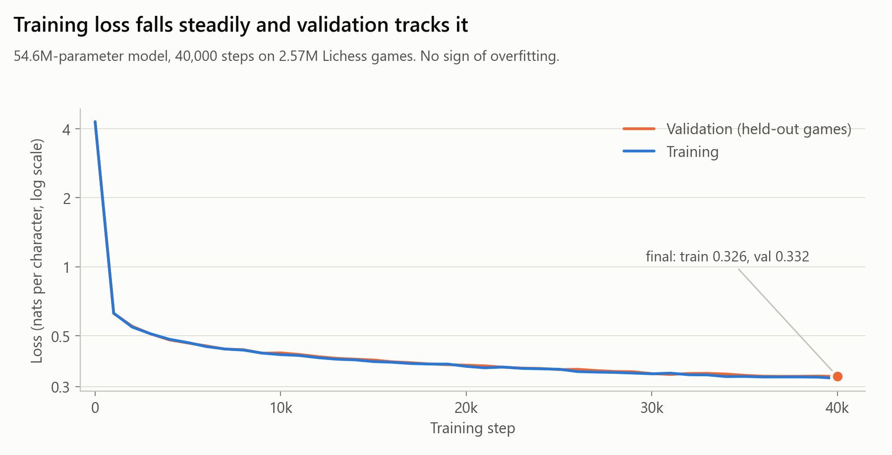
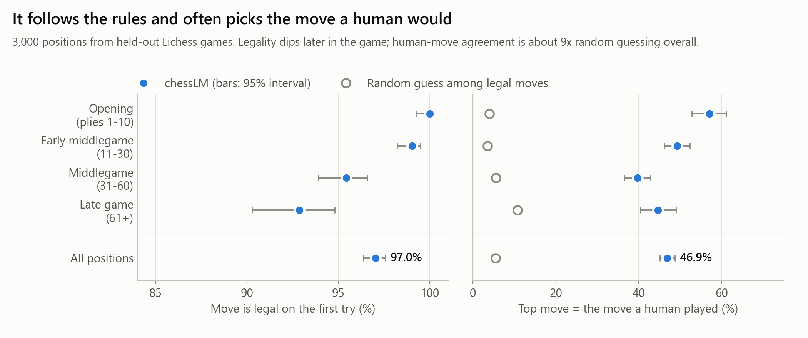
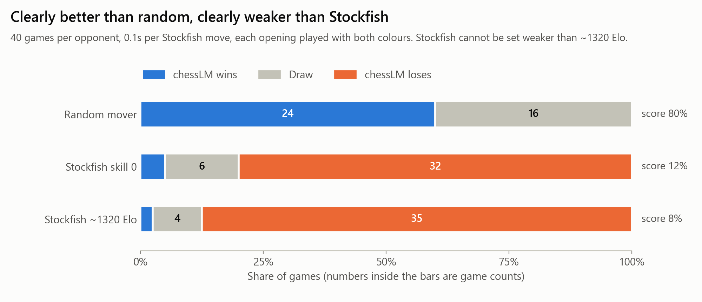
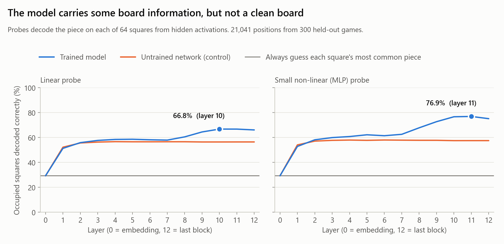
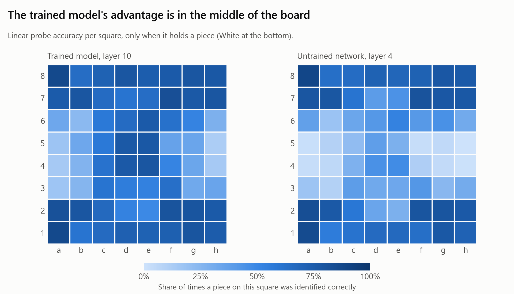
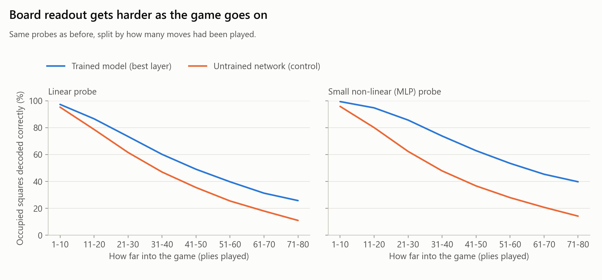
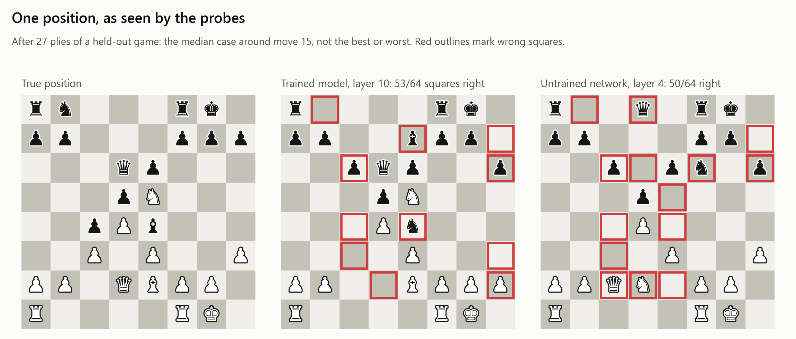

# chessLM

A 54.6M-parameter transformer trained from scratch on Lichess game text. It is never shown the rules or a board, only
move sequences like `;1.e4 e5 2.Nf3 Nc6`. The questions: how much chess does it pick up from text alone, how strong
is it, and does it build a board inside itself?

## Results at a glance

| | Result |
|---|---|
| Training | Validation loss 0.332 nats per character, train 0.326 (no overfitting) |
| Rules | Writes a legal move on its first try **97.0%** of the time on held-out positions (92.9% in the late game) |
| Human-like play | Its top-ranked move is the move a human actually played **46.9%** of the time (random guessing: 5.4%) |
| Strength | Beats a random mover (24 wins, 16 draws, 0 losses), loses to Stockfish at its weakest settings (skill 0: 2 wins, 6 draws, 32 losses; ~1320 Elo: 1 win, 4 draws, 35 losses) |
| Board representation | A small probe recovers the piece on **76.9%** of occupied squares from hidden activations (untrained network: 58.0%), but gets the whole board right only 15.1% of the time |

In short: it has learned to play legal, human-looking chess and carries a real but partial picture of the board. It is
a weak player, and this README says where and why.

<!-- Add a screenshot of the web interface here (python play.py) -->

## Play against it

```bash
python play.py        # opens http://127.0.0.1:8000
```

[play.py](play.py) serves a click-to-move board ([play.html](play.html)). The model only knows game text, so its move is
produced in one of two ways:

- **Free:** it writes the move as text. If the move is illegal it resamples (up to 5 times), then falls back to its
  best legal move. The page counts illegal guesses, which shows how well it learned the rules.
- **Legal only:** every legal move is scored by its likelihood under the model, and one is picked (temperature sets randomness).

After each move the page shows the model's top candidate moves with probabilities.

## How it works

- **Data:** Lichess standard rated games from January to April 2016, keeping only games where both players were rated
  1800 or higher, ended normally, and were not bullet. After removing the few games longer than 1024 characters,
  2,583,237 games remain (2,570,320 for training, 12,917 held out).
- **Format:** each game is one line of standard algebraic notation, `;1.e4 e5 2.Nf3 ...`, with `;` as the start marker.
  Games are stored one per row and never split, so the model always sees a game from move 1.
- **Tokenizer:** character-level, 33 symbols (padded to a vocabulary of 64). See [chess_tokenizer.py](chess_tokenizer.py).
- **Model:** a Llama-style decoder ([model.py](model.py)): 12 layers, model dimension 640, 10 attention heads sharing 5
  key/value heads, RMSNorm, rotary position embeddings, SwiGLU, tied embeddings, 1024-character context.
- **Training:** 40,000 steps, effective batch of 32 games, AdamW with a peak learning rate of 6e-4, 500 warmup steps and
  cosine decay to 10%, bf16. About 5 hours on one RTX 4070 Ti Super, roughly 0.5 billion characters seen.



## Evaluation

Everything below uses games the model never trained on, one checkpoint, and temperature 0.5. The commands are in
[Reproduce](#reproduce).

### Does it follow the rules, and does it choose human-like moves?

3,000 positions were sampled from held-out games. For each, the model gets the real game so far and is asked for the
next move. "Legal first try" is whether the move it writes (free sampling) is legal. "Top-1" ranks every legal move by
the model's likelihood and checks whether the move the human played is ranked first. 95% intervals are in brackets.

| Game phase | Positions | Legal first try | Top-1 = human move | Top-3 | Top-5 | Random top-1 |
|---|---|---|---|---|---|---|
| Opening (plies 1-10) | 538 | 100.0% (99.3-100.0) | 57.1% (52.8-61.2) | 84.8% | 93.9% | 3.9% |
| Early middlegame (11-30) | 1018 | 99.0% (98.2-99.5) | 49.3% (46.2-52.4) | 75.6% | 85.4% | 3.5% |
| Middlegame (31-60) | 940 | 95.4% (93.9-96.6) | 39.7% (36.6-42.8) | 67.0% | 77.1% | 5.5% |
| Late game (61+) | 504 | 92.9% (90.3-94.8) | 44.6% (40.4-49.0) | 72.4% | 81.0% | 10.7% |
| **All** | 3000 | 97.0% (96.4-97.6) | 46.9% (45.1-48.7) | 74.0% | 83.6% | 5.4% |



Legality drops as games get longer, which is also when positions are furthest from anything common in the data.
Human-move agreement is highest in the opening, where good moves are well known.

### How strong is it?

Each opponent played 40 games, 20 openings with both colours. The openings are the first four plies of real held-out
games. Stockfish gets 0.1 seconds per move. The model plays the "free" policy: an illegal move is resampled, and after 5
failures it plays its best-scoring legal move.

| Opponent | Games | Win / Draw / Loss | Score | Elo difference | Legal first try |
|---|---|---|---|---|---|
| Random mover | 40 | 24 / 16 / 0 | 80% | +241 (+109 to +372) | 79.3% |
| Stockfish, skill level 0 | 40 | 2 / 6 / 32 | 12% | -338 (-495 to -181) | 93.0% |
| Stockfish, limited to ~1320 Elo | 40 | 1 / 4 / 35 | 8% | -436 (-631 to -242) | 94.7% |



How to read this:

- **It has learned something real:** it never lost to a random mover. But it only won 24 of 40, and the rest were draws,
  so it often fails to turn a won position into checkmate.
- **It is weak:** it lost most games against the weakest Stockfish settings. Against the ~1320 setting the score implies
  roughly 880 on Stockfish's own Elo scale, with an interval of about 690 to 1080. That scale is not Lichess or FIDE
  Elo, and the estimate rests on 40 games against one opponent far above it, so treat it as "well below 1320", not a
  rating. Stockfish cannot be set weaker than about 1320, so a finer ladder is not possible.
- **Positions it hasn't seen hurt:** its first-try legality drops to 79% against a random mover, whose moves create
  positions the model never met in training.
- All games are saved as PGN in [results/](results/).

### Does it build a board inside itself?

The model only ever reads move text. If a probe can read the piece on each square out of its hidden activations, the
model must be tracking the position somehow.

**Method** ([probe.py](probe.py)):

- 1,500 held-out games train the probes, and 300 different games test them (21,041 test positions).
- Activations are recorded at the character just before each move, where the model must already know the position, at
  every layer (0 is the embedding, 12 is the last block).
- The target is the board after the previous move: for each of the 64 squares, one of 13 classes (empty, or one of the
  six piece types in either colour).
- Two probes per layer: a single linear layer, and a small network with one hidden layer of 512 units.
- **Control:** the identical procedure on a randomly initialised network of the same size. A random network still carries
  simple statistics of the text it has read, so this shows how much of the board is readable without any chess
  knowledge.
- **Baseline:** always guess each square's most common occupant.

| Probe | Trained model | Untrained control | Always-guess baseline |
|---|---|---|---|
| Linear, occupied squares | 66.8% (layer 10) | 56.7% | 29.3% |
| Linear, all 64 squares | 83.2% | 79.9% | 67.6% |
| Small MLP, occupied squares | **76.9%** (layer 11) | 58.0% | 29.3% |
| Small MLP, all 64 squares | 88.8% | 79.4% | 67.6% |
| Small MLP, whole board exactly right | 15.1% | 6.7% | n/a |



What the results say:

- **There is a real signal.** In the last few layers the trained model is clearly more readable than the untrained
  network, and a non-linear probe finds more: 76.9% against 58.0% for the control, a gap of 19 points, versus 10 points
  for the linear probe. The control gains only about a point from the extra capacity, so the probe is not doing the
  work itself.
- **It is partial.** The whole board is exactly right in only 15% of positions, and readability falls steadily through
  the game, from 99% of occupied squares in the first 10 plies to 40% after 70 plies (small probe).
- **The model's advantage is in the middle of the board.** Both networks do well on the back ranks, where pieces rarely
  move. The trained model is much better on central squares.







Notes on the method, so the numbers can be judged fairly:

- The probes look converged: in a check on a validation slice of the training games (linear probe only), training
  longer or with a higher learning rate changed accuracy by under one point, so these numbers are limited by the
  model, not by under-training the probe. I did not repeat that check for the MLP probe.
- I first probed after every move, then switched to just before each move. After Black's move the model's next
  character is a move number, which needs no board knowledge, so half of those positions were not decision points. The
  switch was made after a small pilot on separate games, and the final run used fresh games.
- The example position is the median case at plies 25-35 (by trained-minus-control squares correct), not the best or
  worst. The first position I plotted happened to favour the untrained control, which would have been misleading.
- Probing shows information is *present*, not that the model *uses* it. I did not run causal interventions.
- Published work on chess language models trained for much longer reports cleaner board representations. This model saw
  about 0.5 billion characters, so I would expect the representation to sharpen with more training, but I have not
  tested that.

## Reproduce

```bash
pip install -r requirements.txt            # plus a CUDA build of PyTorch

# data: four Lichess months from https://database.lichess.org, both players rated 1800+
python prepare_chess.py data/raw/lichess_2016-01.pgn.zst data/raw/lichess_2016-02.pgn.zst \
                        data/raw/lichess_2016-03.pgn.zst data/raw/lichess_2016-04.pgn.zst \
                        --min_elo 1800 --out_dir data_big
python verify_data.py --data_dir data_big            # every prepared game must replay legally

# train (about 5 hours); add --resume to continue an interrupted run from out/base_last.pt
python train.py --size base --data_dir data_big --batch_size 16 --grad_accum 2 \
                --max_iters 40000 --lr 6e-4 --warmup 500 --eval_every 1000

# evaluate (Stockfish: download it from stockfishchess.org into tools/, or put it on your PATH)
python evaluate.py legal --n 3000
python evaluate.py stockfish --opponents random skill:0 elo:1320 --games 40
python probe.py --n_train 1500 --n_test 300 --epochs 20 --seed 2

python make_figures.py                                # rebuilds figures/ from results/ and the training log
python play.py                                        # play against it
```

Do not run the evaluations on the GPU at the same time as training or as each other: a concurrent run crashed once
with a CUDA error and ran cleanly when repeated alone.

## Project layout

```
chess_tokenizer.py  character vocabulary
prepare_chess.py    Lichess dump -> fixed-length game records
verify_data.py      replays prepared games with python-chess
model.py            the transformer
train.py            training loop (resumable)
play.py, play.html  web interface; play.py also holds the shared move-choosing logic
evaluate.py         legality / human-move agreement, and games against Stockfish
probe.py            board-state probing
make_figures.py     builds every figure in figures/
results/            JSON and markdown tables, plus the PGN of every evaluation game
figures/            the figures used above
```

## Limitations

- It is a weak player. It loses most games against even the weakest Stockfish settings (32 and 35 of 40), and it does
  not reliably convert winning positions.
- The context holds about 120 plies, so very long games cannot be continued.
- Trained on 1800+ rated Lichess games from four months of 2016 only. Play from other eras, time controls or rating
  levels is untested.
- Results are for a single checkpoint, a single temperature (0.5), and 40 games per opponent. Intervals are wide.
- The Stockfish-based strength figure is on Stockfish's own scale, not a rating you could compare with Lichess or FIDE.
- The board probing is correlational and covers one model.

## Ideas for next steps

- [ ] Train a longer v2 on more data and re-run the same evaluation and probing, to see whether more compute sharpens
  the board representation (a small scaling study; plan and checklist in [V2_PLAN.md](V2_PLAN.md))
- [ ] Causal tests: edit the decoded board inside the model and check whether its move choice changes
- [ ] Add a KV cache so the web interface responds faster in long games

## Acknowledgements

- [Lichess open database](https://database.lichess.org) (CC0), [Stockfish](https://stockfishchess.org),
  and [python-chess](https://python-chess.readthedocs.io)
- Karvonen, *Emergent World Models and Latent Variable Estimation in Chess-Playing Language Models* (2024), and
  Li et al., *Emergent World Representations: Exploring a Sequence Model Trained on a Synthetic Task* (2023), which
  inspired the probing experiment
